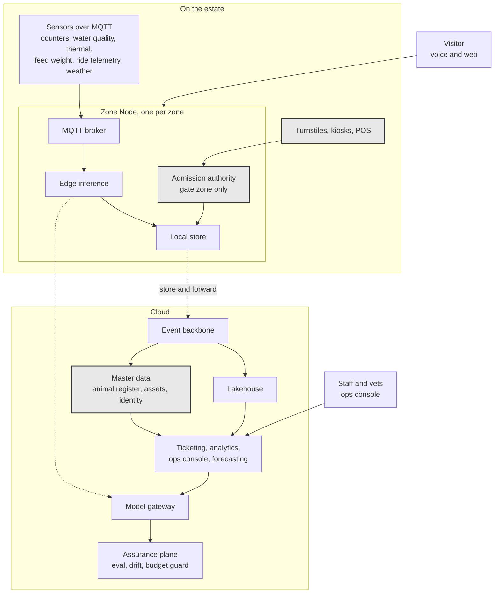

# Solution strategy

*arc42 section 4. This is the short version of the whole architecture. If you
read one file in this repository, read this one.*

## The decision everything else follows from

We divide the estate into **zones**, and the zone is the unit of connectivity,
authority, state, analytics, staffing, and AI deployment.

Each zone has a **Zone Node**: edge compute, an MQTT broker, local storage,
local inference, and a zone ops view for staff tablets. The Zone Node owns what
happens in its zone. The cloud is where zones reconcile, not where they live.

Admission is a perimeter concern, so only the gate zone's node runs the
admission service, for every turnstile lane, and that node is the one with a
warm standby. Internal zones are not gated.

We reached this by treating the estate as a distributed real-time world rather
than as a website with sensors attached. Participants moving through a bounded
space divided into regions, over a network that intermittently fails, is the
problem multiplayer game servers solved, and one of us spent years building
them. Most of that discipline does not transfer. Three ideas do, and they are
the ones this architecture is built on. What remains is ordinary edge computing
with store and forward, and we say so rather than dress it up.

Patchy WiFi stops being a constraint we work around and becomes the organizing
principle of the design.

| Borrowed | What it does here |
|---|---|
| Zone authority | The zone is the source of truth for what happens inside it. The gate keeps admitting visitors, and every zone keeps monitoring its enclosures, when the cloud is unreachable |
| Server authoritative state | Ticket validation is never trusted to the visitor's device. The gate verifies a signature |
| Area of interest | The local concierge holds state for its own zone and its neighbours only, which is why it answers from cache during a partition and why the zone state cache stays small |

Not borrowed, because nothing here uses them: client side prediction, which
needs a client and there is no app, and dead reckoning, because occupancy is
measured rather than extrapolated.

## The shape of the system

**Key.** `[box]` component we build · `[(cylinder)]` data store ·
enclosing box a boundary · **gray fill** deterministic floor, no model output permitted ·
**solid** synchronous dependency · **dotted** store and forward, source survives target failure.
Full notation: [3_10-diagram-legend.md](3_10-diagram-legend.md).

The dotted line from the Zone Node to the event backbone is the important one.
It is store and forward, not a dependency. Everything on the estate side keeps
functioning when that line is down.

## Four layers

**Layer 0, the deterministic floor.** Ticketing, admission, payment, point of
sale, and the statutory animal register. No model output is permitted anywhere
in this path. The mechanism is offline-verifiable tickets: a cryptographically
signed credential a turnstile validates with no network round trip, with
revocation data syncing opportunistically. The estate can sell on site and
admit with every cloud service and every model provider dark. Online sales are
the one Tier 0 function that lives in the cloud, and the degraded mode matrix
says so.

**Layer 1, sensing.** MQTT devices throughout the park. Two rules govern the
whole layer. Mounting is non-invasive because the rides are protected
structures, and the edge ships events and embeddings rather than video, because
bandwidth is the scarce resource and video is the expensive thing to move.

**Layer 2, data.** Event backbone from zones to cloud, a lakehouse behind it,
and three master data sets: the animal register, which is a legal record; the
asset register; and visitor identity. Fiscal and behavioral data are physically
separated because their retention obligations point in opposite directions.

**Layer 3, AI.** Split by audience, because the brief asks for both. Operations
gets animal welfare split into aquatic and terrestrial, piranha population
estimation, predictive maintenance, staff deployment, and demand forecasting.
Visitors get a voice-first concierge, accessibility and translation, wayfinding
and itinerary suggestions.

Every capability in Layer 3 carries a tier, a fallback, and a verification
method. See
[2_3-architecture-characteristics.md](../02-requirements/2_3-architecture-characteristics.md).

## Two components that do disproportionate work

**The model gateway.** Every model call routes through it. It handles provider
abstraction, routing, caching, budget accounting, and logging. That single
component is simultaneously the seam for substituting a provider, the
instrumentation point for all evaluation, and the enforcement point for the
EUR 0.10 per scanned admission ceiling. One component satisfying three characteristics is
worth more than three components satisfying one each, and a static check
forbids importing any provider SDK outside it.

**The heuristic baseline.** Greenfield means no historical data, so every model
starts cold. Phases 0 and 1 run on rules plus external signals: weather,
regional school holidays, time of day, season. Models replace a heuristic only
when evaluation beats it by a defined margin, and the heuristic is never
deleted. It stays in place as the permanent fallback for every tier.

The same mechanism solves cold start and graceful degradation. That is why it
earns a place in the strategy rather than sitting in an implementation note.

## How the strategy answers what the Countess asked for

| Her problem | Our answer |
|---|---|
| Sell tickets and family passes | Layer 0, offline-verifiable, works on site during any outage |
| Know which parts are popular | Anonymous edge counting per zone, aggregated, no images retained |
| Know where to deploy staff | Zone demand forecasts as aggregate advisory signals. A human assigns |
| Healthy and happy animals | Continuous per-enclosure monitoring, split aquatic and terrestrial, advisory alerts confirmed by a vet |
| Count the jumping piranhas | A population estimate with a confidence interval, alerting on trend, never a bare number |
| Grow visitors and profit | Demand forecasting, return-visit products, and a hard ceiling on what AI is allowed to cost |
| More returning visitors | Voice concierge, accessibility, and itinerary suggestions that make a second visit better than the first |

## What we chose not to do

**No AI in the revenue path.** Ticketing and admission are deterministic by
decision, not by omission.

**No individual staff tracking.** Aggregate zone signals only, which is both a
legal requirement and a better design.

**No facial recognition or biometric identification anywhere.** Counting is
anonymous and happens at the edge.

**No app requirement.** Anything that assumes a download has to work without
one.

**No elastic scale architecture.** The estate's load is predictable within a
day and a season, so provisioning against a known peak is cheaper.

**No multi-region deployment.** One estate, one location. A failover story
would cost operability, which we ranked higher.

## Phasing

| Phase | Window | What ships |
|---|---|---|
| 0 | 0 to 6 months | Survey, procurement and permissions, then Layer 0 and connectivity. Zero AI |
| 1 | 6 to 12 months | Sensing, data platform, welfare monitoring on heuristics |
| 2 | 12 to 18 months | AI capabilities as evaluation beats each baseline |
| 3 | 18 to 36 months | Scale toward 15,000 per day, optimize, extend |

Phase 0 carries no AI on purpose. The estate has to sell a ticket and admit a
visitor before it does anything clever, and that ordering is the whole argument
of this architecture in miniature.
