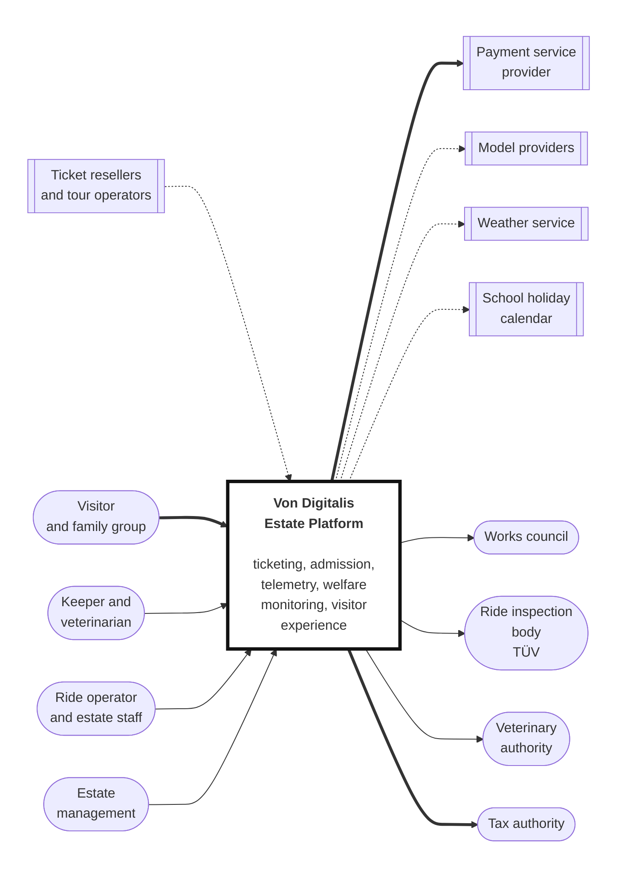

# System context

*arc42 section 3. Who and what the estate platform talks to, and why.*

Notation is defined in [3_10-diagram-legend.md](3_10-diagram-legend.md).

**Key.** `([rounded])` person or external organization · `[box]` component we build ·
`[[double bar]]` third party service we depend on but do not run ·
**solid** synchronous dependency · **dotted** store and forward, source survives target failure ·
**thick** the revenue path · **thick black border** the system under design.
Full notation: [3_10-diagram-legend.md](3_10-diagram-legend.md).

## The people

| Who | What they need from the system |
|---|---|
| **Visitor and family group** | Buy a ticket, get in, find their way, ask questions, know how long the queue is |
| **Keeper and veterinarian** | Know which animals need attention, record what they did, satisfy the statutory record |
| **Ride operator and estate staff** | Know where to be, know what is running, report a problem |
| **Estate management** | Know what is popular, what it costs, whether the estate is heading toward 15,000 visitors a day |
| **Works council** | Assurance that no system monitors individual staff performance. Their agreement is a legal precondition, not a nice to have |

The works council is drawn as an outbound arrow because the flow runs the other
way from the rest. The system does not serve them, it has to satisfy them. Under
BetrVG section 87(1)(6), a technical system merely *capable* of monitoring staff
performance requires their agreement before it operates. That makes them a
stakeholder with veto, which is a rare shape on a context diagram and worth
drawing rather than burying in a requirements table.

## The external systems

| What | Why | If it disappears |
|---|---|---|
| **Payment service provider** | Card and wallet acceptance. Card data never touches estate infrastructure | Admission continues on pre-purchased and offline validated tickets. On-site sales stop |
| **Model providers** | Inference for Tier 1, 2 and 3 capabilities | Every AI capability degrades to its heuristic baseline. Nothing in Tier 0 is affected. See [8_1](../08-risks-and-uncertainty/8_1-ai-provider-uncertainty.md) |
| **Weather service** | The largest single driver of daily attendance at an outdoor attraction, and an input to animal behavior | Forecasting falls back to seasonal averages |
| **Bavarian school holiday calendar** | Published, predictable, and a strong seasonality signal | Static calendar copy, refreshed annually |
| **Ticket resellers and tour operators** | Distribution beyond the estate's own channel | Direct sales continue |
| **Ride inspection body** | Statutory inspection of the rides. We supply condition data, they decide | No effect on the platform. Inspection is their process, not ours |
| **Veterinary authority** | Notifiable disease reporting runs to them, after human veterinary confirmation | Reporting reverts to the manual path, which is the legal fallback anyway |
| **Tax authority** | Fiscal records and receipts | Records are retained locally and submitted when reachable. Point of sale does not stop |

## What this diagram is arguing

Three things, stated visually.

**Every dependency that could fail has a stated consequence.** The right-hand
column above is the real content of this page. A context diagram that names
dependencies without saying what happens when they break is a picture, not an
analysis.

**Only three arrows are thick.** Visitor to system, system to payment, system to
tax authority. That is the revenue path, and it is the thing that must never
stop. Everything on it is in the deterministic floor.

**Everything to a model provider is dotted.** Inference is never on a path the
estate depends on to function. That is not an accident of drawing, it is the
architecture.

## What is deliberately not here

**No app store or mobile platform.** Nothing in the visitor experience requires
an installed app, so neither is a dependency.

**No identity provider for visitors.** Buying a ticket does not require an
account. Adding one would create a personal data obligation for no benefit the
Countess asked for.

**No social media or marketing platform.** Return visits matter, but the
mechanism belongs in a later phase and would be a distraction on a context
diagram for phase zero.
