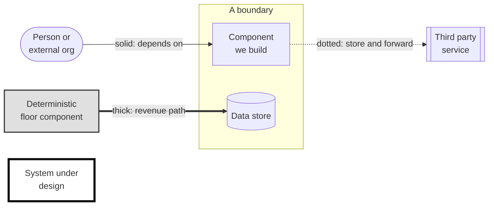

# Diagram legend

The brief asks that if we use different shapes to mean different things, we
provide a key. This is the key. Every diagram in this repository uses this
notation and nothing else.

We kept it deliberately small. Seven symbols, four line styles, and one further diagram type. A notation that
needs a long legend is a notation that is doing the reader's work badly.

## Shapes

| Symbol | Meaning |
|---|---|
| `([Rounded])` | A person or an organization outside our system. Visitors, keepers, vets, the works council, an inspection body |
| `[Rectangle]` | A component we build or operate |
| `[(Cylinder)]` | A data store |
| `[[Subroutine]]` | A third party service we depend on but do not run, or a bought product we operate through its vendor |
| `{Diamond}` | A decision point in a targeted view, with the condition on each outgoing arrow |
| Enclosing box with a title | A boundary: the estate, the cloud, a single zone |
| Gray fill | **The deterministic floor.** No model output is permitted in this component. See the tier model in [2_3](../02-requirements/2_3-architecture-characteristics.md) |
| Thick black border | The system under design, used only on the context diagram where the whole platform is one box |

## Lines

| Style | Meaning |
|---|---|
| Solid arrow | A synchronous call or a direct flow. The source depends on the target being available |
| Dotted arrow | Asynchronous, store and forward, or best effort. The source keeps working when the target is unreachable |
| Thick arrow | The revenue path. Ticket purchase through to admission |
| Unlabeled arrow | Direction of data flow, where the label would add nothing |

The distinction between solid and dotted carries most of the meaning in this
architecture. Everything crossing from the estate to the cloud is dotted, and
that is the whole argument about partition tolerance stated visually.

## Reference

## Sequence diagrams

Where the order of events carries the meaning, a sequence diagram is used
instead of numbering arrows on a structural one. There is one, for the
partition and reconciliation flow in [3_5](3_5-connectivity-and-edge.md).

| Element | Meaning |
|---|---|
| Participant | A component or device, named as in the container view |
| Solid arrow | A call or message the sender waits on |
| Dashed arrow | A response, or a message the sender does not wait on |
| Note | A condition, or a moment in time |

## What we do not use

No colors beyond the single gray fill, because color is unreliable across
themes, print, and color vision differences, and because a reader should not
have to remember what blue meant.

No UML stereotypes, no custom iconography, no numbered flow annotations. Where
a sequence matters, we draw a sequence diagram rather than numbering arrows on
a structural one.

## The rule we hold ourselves to

Every diagram in this repository carries a short inline **Key** directly beneath
it, naming only the symbols that diagram actually uses, and a link back to this
page for the full notation.

A reader should never have to navigate away to understand a picture. The brief
asks for a key where shapes carry meaning, and a judge reading a dozen
repositories will not click through to find one.

This is checked mechanically rather than remembered. A file containing a
diagram without an inline key fails our documentation check.
