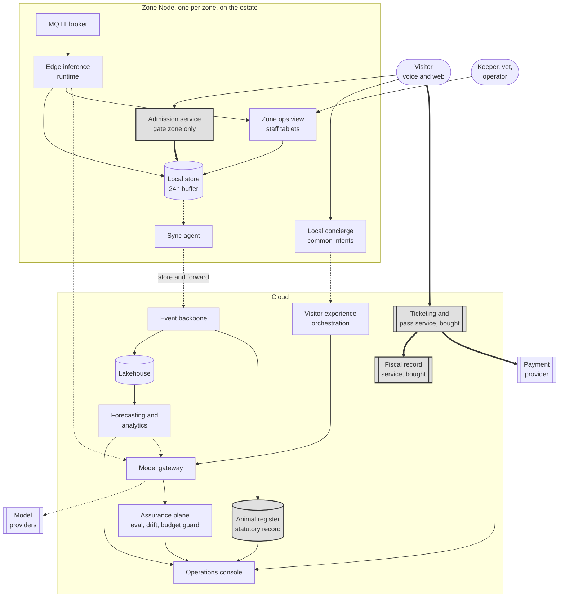

# Container view

*arc42 section 5. What the platform is made of, where each part runs, and which
parts are forbidden from containing model output.*

**Key.** `([rounded])` person · `[box]` container we build · `[(cylinder)]` data store ·
`[[double bar]]` third party service or bought product · enclosing box a boundary ·
**gray fill** deterministic floor, no model output permitted ·
**solid** synchronous dependency · **dotted** store and forward, source survives target failure ·
**thick** the revenue path.
Full notation: [3_10-diagram-legend.md](3_10-diagram-legend.md).

## The Zone Node

Everything here runs on the estate, one instance per zone, and keeps running
when the cloud is unreachable.

| Container | Responsibility | Tier |
|---|---|---|
| **Admission service**, gate zone only | Validates signed ticket credentials offline against issuer certificates and the last synchronized revocation list. Records every admission locally. Admission is a perimeter concern, so this runs on the gate zone's node, which has a warm standby. Internal zones are not gated | **0** |
| **MQTT broker** | Terminates every sensor in the zone. Nothing talks to the cloud directly | n/a |
| **Edge inference runtime** | Anonymous people counting, water quality anomaly detection, activity classification. Frames never leave the device | 1 |
| **Local store** | 24 hours of admissions, telemetry and fiscal records, buffered for reconciliation | 0 |
| **Sync agent** | Store and forward to the cloud. Opportunistic, idempotent, resumable | n/a |
| **Local concierge** | Resolves common visitor intents without leaving the zone: opening hours, directions, queue length | 2 |
| **Zone ops view** | The keeper's and operator's screen for this zone, served from the Zone Node to staff tablets over the local network. Shows enclosure state and welfare concerns, takes observations and dismissals, and queues register entries for the cloud when the link is down. It is where a partition alert actually lands | 1 |

The local concierge matters more than it looks. Most visitor questions are the
same twenty questions, and answering them in the zone keeps latency low, keeps
inference cost near zero, and keeps the estate useful during an outage. Only
open-ended queries escalate to the cloud, which is also the cheapest possible
answer to the EUR 0.10 ceiling.

## The cloud

| Container | Responsibility | Tier |
|---|---|---|
| **Ticketing and pass service**, bought | Sells tickets, issues signed credentials, delegates a daily issuing key to each point of sale unit, manages family and season passes. A bought product, [ADR-0012](../07-decisions/ADR-0012-buy-ticketing-build-the-ai.md) | **0** |
| **Fiscal record service**, bought | Produces compliant records and receipts, retains for the statutory period. Part of the bought platform | **0** |
| **Animal register** | The statutory record of the collection. AI writes nothing here | **0** |
| **Event backbone** | Ingests everything the zones forward | n/a |
| **Lakehouse** | Analytical storage, behavioral data, separated from fiscal | n/a |
| **Model gateway** | Every model call. Routing, caching, budget accounting, logging, provider abstraction | n/a |
| **Assurance plane** | Evaluation runs, drift detection, budget guard, output sampling | n/a |
| **Visitor experience orchestration** | Open-ended concierge queries, translation, itinerary suggestions | 2 |
| **Forecasting and analytics** | Demand forecasts, footfall aggregation, staff deployment advice | 1 and 3 |
| **Operations console** | What keepers, vets, operators and management actually use | 1 |

## Three things this diagram is arguing

**Four containers are shaded and none of them touch the model gateway.**
Admission, ticketing, fiscal records and the animal register have no path to
inference. Two of the four are bought, which is why they carry the double bar
as well as the gray fill: the floor is partly a vendor product, and ADR-0012
says what that costs. That is the deterministic floor, drawn rather than
asserted.

**Every line crossing from estate to cloud is dotted.** The sync agent to the
event backbone carries the data, the local concierge's escalation is the only
other, and both are best effort. The estate does not depend on the cloud to
function.

**Everything that talks to a model provider goes through one box.** Edge
inference, visitor experience, and forecasting all route through the gateway,
and the gateway is the only thing holding a provider SDK. That is what makes
the two day substitution target in NFR-34 plausible rather than aspirational.

## What is not a container

**No separate AI service per capability.** Capabilities are configurations of
the gateway plus their own evaluation assets, not standalone services. Eight
microservices each wrapping a different model would give the two person
operations team eight things to run for no architectural benefit.

**No message queue between cloud containers.** The event backbone handles
ingestion from zones. Cloud-internal communication is direct, because adding a
broker we do not need is exactly the kind of decision that fails FF-06.

**No API gateway.** With one estate, one set of clients, and no third party
consumers in phase zero, it would be a component to operate rather than a
problem solved.
