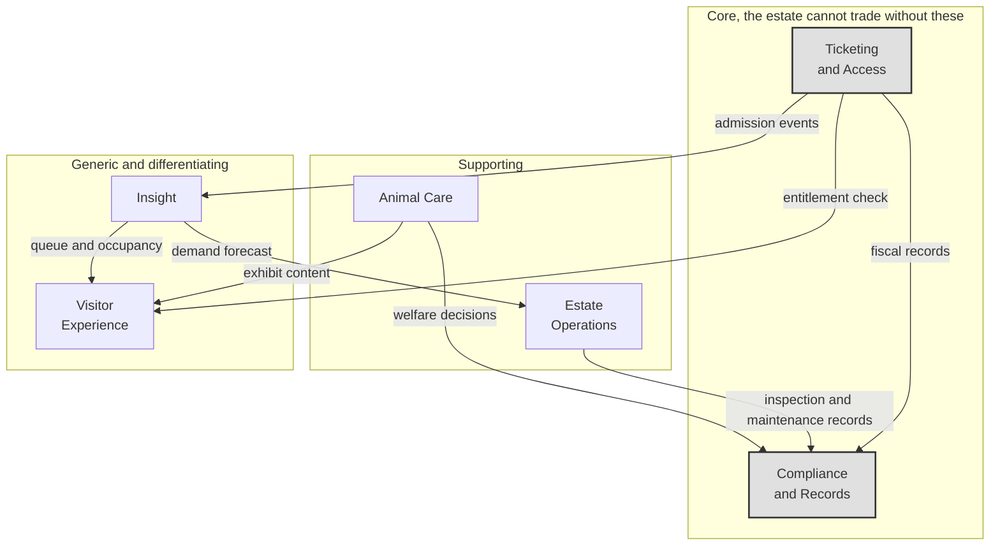

# Domain model and bounded contexts

*The estate is not one domain. Treating it as one is how you get a system where
a change to ticket pricing breaks animal feeding records.*

## Six bounded contexts

**Key.** `[box]` bounded context · enclosing box a grouping ·
**gray fill** contains Tier 0 capabilities, no model output permitted ·
**solid** a published flow between contexts, labelled with what crosses.
Full notation: [3_10-diagram-legend.md](3_10-diagram-legend.md).

| Context | Owns | Language it speaks |
|---|---|---|
| **Ticketing and Access** | Products, passes, entitlements, credentials, admission | Ticket, pass, entitlement, credential, admission |
| **Compliance and Records** | The statutory animal register, fiscal records, retention, audit | Register entry, observation, record, retention period |
| **Animal Care** | Animals, enclosures, feeding, health, welfare decisions | Animal, enclosure, feeding event, welfare concern, observation |
| **Estate Operations** | Rides, assets, maintenance, staffing, zones | Ride, asset, condition, shift, zone |
| **Visitor Experience** | Intents, answers, wayfinding, translation | Intent, answer, route, language |
| **Insight** | Occupancy, forecasts, cohorts | Count, forecast, cohort, trend |

## The distinction that carries the most weight

**Animal Care and Compliance and Records are separate contexts, and the word
"observation" means different things in each.**

In Animal Care, an observation is operational. A keeper noticed something, a
sensor reported something, a model flagged something. It is provisional, it can
be wrong, and it exists to prompt action.

In Compliance and Records, an observation is a statutory entry. It has an
author who is professionally accountable, a timestamp, and evidence. It is not
provisional.

Collapsing these into one model is the mistake that would let a model-generated
alert end up in a licensing record. Keeping them separate is what makes
[ADR-0010](../07-decisions/ADR-0010-animal-register-as-system-of-record.md)
enforceable rather than aspirational: the translation from one to the other
requires a human act, and the contexts speak different languages either side of
it.

## Aggregates worth naming

| Aggregate | Context | Invariant it protects |
|---|---|---|
| **Pass** | Ticketing and Access | Group size, validity window, and single use per visit. Enforced at the gate without a network |
| **Animal** | Animal Care | Identity, enclosure membership and provenance. Never merged with health state |
| **Enclosure** | Animal Care | Occupants, environmental bands, feeding schedule. The unit welfare monitoring reasons about |
| **Register Entry** | Compliance and Records | Immutable once written, with an accountable author |
| **Ride** | Estate Operations | Condition history and inspection status, which are separate things |

**Animal and Enclosure are separate aggregates**, and the aquatic case is why.
Water chemistry is a property of the enclosure and affects every occupant
simultaneously. Modelling health as purely an animal property would make that
impossible to express.

## Context relationships

| Upstream | Downstream | Pattern |
|---|---|---|
| Ticketing and Access | Insight | Published events. Insight has no influence on how admission works |
| Animal Care | Compliance and Records | **Anti-corruption layer.** Operational language must not leak into the statutory model |
| Insight | Estate Operations | Published forecast. Operations may ignore it, and often should |
| Ticketing and Access | Visitor Experience | Entitlement check only. The concierge never sees purchase history |

The anti-corruption layer on row two is the architectural expression of the
human-in-the-loop requirement. A welfare concern cannot become a register entry
by passing through a mapper. It becomes one when a qualified person decides it
has.

## What we did not model

**No Marketing context.** Return visit mechanisms are phase 3 and we have not
designed them. A context with nothing in it is worse than an admitted gap.

**No Finance context beyond fiscal records.** The estate has accounting systems
we know nothing about. Fiscal records are produced and handed over.

**No unified Visitor aggregate.** Deliberately. A visitor is an entitlement at
the gate and an anonymous count in Insight, and joining those would require the
identification that [ADR-0008](../07-decisions/ADR-0008-anonymous-edge-counting.md)
forbids. The absence of this aggregate is a privacy decision expressed in the
domain model. The ticketing platform holds a purchaser record for receipts and
refunds and computes repeat purchase rates on it. We consume the aggregate and
never import the record.
