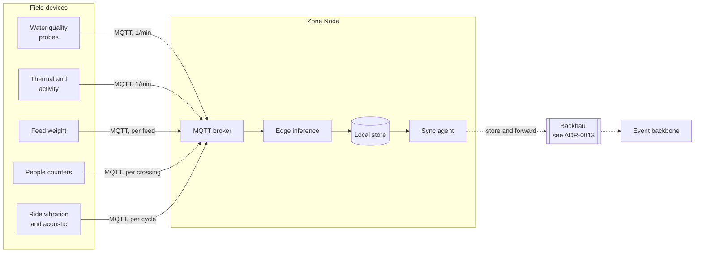
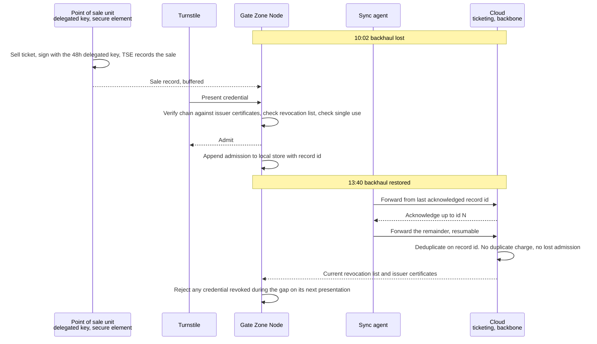

# Connectivity and the edge

*arc42 section 7, partly. How data physically moves across an estate where the
network cannot be relied on.*

## The layers

**Key.** `[box]` component we build · `[(cylinder)]` data store ·
`[[double bar]]` third party or undecided infrastructure · enclosing box a boundary ·
**solid** synchronous or direct · **dotted** store and forward, source survives target failure.
Full notation: [3_10-diagram-legend.md](3_10-diagram-legend.md).

## Why MQTT

The brief provides budget for MQTT capable hardware, which settles the field
protocol. It is also the right answer independently: publish and subscribe suits
many sensors and few consumers, it tolerates intermittent links, and quality of
service levels let us choose per topic whether a missed message matters.

Water quality readings use at-least-once delivery, because a missed reading in a
trend is a gap in evidence. People counter crossings use at-most-once, because
one missed crossing in a count of thousands is noise and the cheaper delivery
suits battery devices.

## What crosses the boundary, and what does not

This is the decision that makes the bandwidth budget work.

| Stays on the Zone Node | Crosses to cloud |
|---|---|
| Camera frames, always, without exception | Counts and classifications |
| Raw high-frequency sensor samples | Aggregates, and raw samples only around an alert |
| Speech audio for local intents | Transcripts and outcomes for escalated queries only |
| Model inference for counting and welfare | Evaluation records, which are small |

Shipping video from ten zones would dominate any backhaul we could afford. It
would also create a children's imagery retention problem we have no need to
have. Processing at the edge and forwarding numbers solves a cost problem and a
privacy problem with one decision.

## Store and forward

The sync agent writes locally first and forwards opportunistically. Three
properties make this safe:

**Idempotent.** Every record carries an identity, so a forward that succeeds
without acknowledgment can be repeated without duplicating an admission or a
charge.

**Resumable.** Transfers pick up from the last acknowledged record rather than
restarting, which matters on a link that drops frequently.

**Bounded.** Twenty four hours of local retention, per NFR-10. Beyond that,
telemetry is downsampled rather than dropped entirely, and Tier 0 records are
never downsampled.

## Runtime view: a partition, and the reconciliation after it

The hardest flow in the architecture is the one nobody draws: the link drops
during trading, the estate carries on, the link returns, and nothing is lost or
doubled. This is that flow, on the gate zone, with an on-site sale in it
because that is the case that needs the delegated key.

**Key.** Participant a component or device · **solid arrow** a call or message the
sender waits on · **dashed arrow** a response, or a message the sender does not
wait on · **note** a moment in time.
Full notation: [3_10-diagram-legend.md](3_10-diagram-legend.md).

Three things this makes visible. The sale and the admission complete with no
message leaving the estate. The forward after reconnect resumes from an
acknowledged id rather than restarting, which is what makes a flapping link
survivable. And the revocation that happened during the gap takes effect on the
next presentation, not retroactively, which is the eventually consistent window
ADR-0004 accepts and measures.

## Backhaul

Undecided. See [ADR-0013](../07-decisions/ADR-0013-connectivity-backhaul.md),
which is recorded as proposed rather than answered, and is the largest open
decision in the architecture.

The architecture is deliberately indifferent to the outcome. Because each zone
holds local authority and every crossing is store and forward, the backhaul
choice affects reconciliation latency and running cost, not correctness. A worse
backhaul makes the estate's data staler, not its turnstiles broken.

## Edge model deployment

The operational cost of choosing edge inference, and the part that is easy to
overlook until it is expensive.

| Requirement | Approach |
|---|---|
| Deploy a model update to ten Zone Nodes over an unreliable link | Staged rollout, one zone first, then the rest |
| Verify the update arrived intact | Signed artefacts, verified before activation |
| Recover from a bad model | Previous version retained locally, automatic rollback on health check failure |
| Know what is running where | Model version reported with every inference record through the gateway |

NFR-19 covers this and it exists because of
[ADR-0002](../07-decisions/ADR-0002-zone-based-edge-architecture.md). Putting
inference at the edge buys partition tolerance and cheap vision, and the price
is a distributed software deployment problem landing on a team of three.

## Power and physical siting

Field devices are battery powered with multi-year cells, because the rides are
protected structures and cabling to them is not permitted. Zone Nodes need mains
power and redundancy, which constrains where they can go.

Enclosures are weatherproof and tamper evident. As noted in the
[threat model](../10-security/10_1-threat-model.md), we assume one will
eventually be opened, and design so that what it holds is worth very little.
