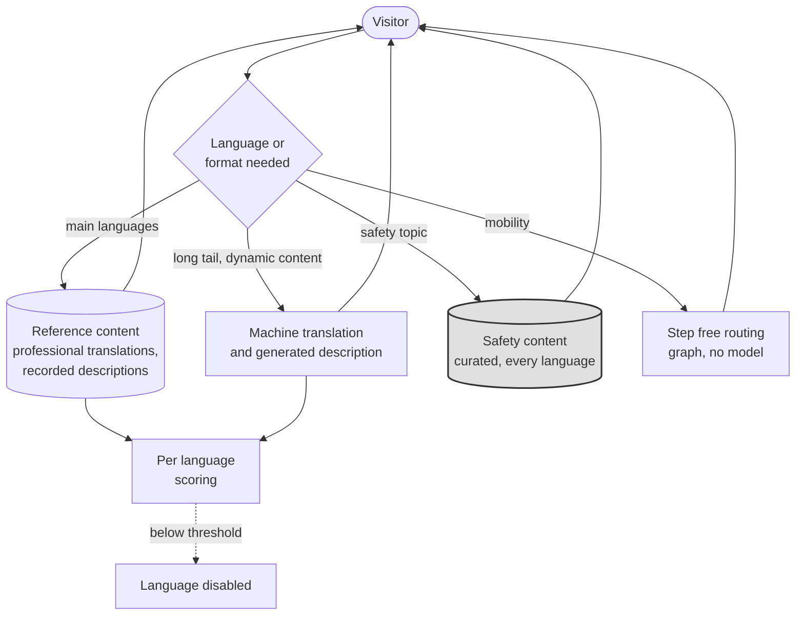

# Accessibility and translation

**Tier 2. Visitor facing. The capability we would fight hardest to keep.**

## Purpose

Two groups of visitors currently have a worse day than everyone else: those with
a disability that the estate does not accommodate, and those who do not read
German.

For a Bavarian estate with international visitors, the second group is large.
The first group is the one the brief never mentions and the law does.

## Why this is in the architecture at all

Three reasons, in ascending order of importance.

**It is a legal obligation.** The BFSG, implementing the European Accessibility
Act and in force since June 2025, requires consumer digital services to be
accessible. Online ticketing must meet EN 301 549 and WCAG 2.2 AA. That covers
the ticketing path but not the estate experience.

**It is the most direct answer to the returning visitor problem.** The Countess
asked how to get people to come back and said she did not know how. An estate
that works for a family with a deaf child, or for a Japanese visitor who cannot
read the signage, is an estate that family comes back to. This is a better
return-visit mechanism than any recommendation engine, and it is buildable now.

**It is the best use of AI in this system.** Most of what we are doing with
models makes an already functional estate more efficient. This makes the estate
usable by people for whom it currently is not.

## Tier and why

Tier 2. Output reaches a visitor directly.

## What it does

| Capability | For whom |
|---|---|
| Real time translation of signage, exhibit content and concierge responses | Visitors who do not read German |
| Audio description of exhibits and wayfinding | Visitors with visual impairments |
| Simplified language versions of exhibit content | Visitors with cognitive disabilities, and children |
| Text alternatives for audio content | Visitors with hearing impairments |
| Step-free route guidance | Visitors with mobility impairments |

Step-free routing is worth noting because it needs no model at all. It is a
graph problem over the estate map, and including it here rather than quietly
dropping it keeps the capability honest about where AI helps and where it does
not.

## Approach and baseline

**Baseline:** professionally translated reference content in the four or five
largest visitor languages, plus static audio description for the main exhibits.
No model. This ships in phase 1 and never goes away.

**Model:** translation of the long tail of languages and of dynamic content
such as queue times and concierge responses, plus generated audio description
for exhibits without a recorded one.

The reference translations do double duty: they serve visitors in the main
languages, and they are the golden set against which machine translation of
those languages is scored.

## Reference content does double duty

**Key.** `([rounded])` person or external body · `[box]` component we build ·
`[(cylinder)]` data store · `{diamond}` decision · enclosing box a boundary ·
**gray fill** deterministic floor, no model output permitted ·
**solid** synchronous or direct · **dotted** advisory or best effort.
Full notation: [../../03-architecture/3_10-diagram-legend.md](../../03-architecture/3_10-diagram-legend.md).

The reference content is both a service and a golden set: it serves visitors in
the main languages and scores machine translation of those same languages.
Step free routing needs no model at all, and including it keeps the capability
honest about where AI helps. A language that scores below threshold is disabled
rather than served badly, because a translation that is subtly wrong is worse
than none when a visitor acts on it.

## The tradeoff we accepted

We accept **provider lock-in** here, and it is recorded as a tradeoff point in
[2_5](../../02-requirements/2_5-quality-scenarios.md).

Everywhere else in this architecture, evolvability at the model boundary ranks
seventh of seven and we still protect it, because provider substitution is a
three-year certainty. Here we are willing to bind to whichever provider produces
the best output for the languages and accessibility formats our visitors need,
even where that means a harder migration.

The reasoning: for most capabilities, a slightly worse model means a slightly
worse answer. Here it means a visually impaired visitor gets a description that
does not tell them what is in front of them, or a translation that is confidently
wrong about where the exit is. Quality is a usability floor rather than a
gradient.

## Holds a reserved floor

Under cost pressure the budget guard degrades the unprotected capabilities in a
fixed order, and accessibility is not in that order at all. It holds a reserved
floor of 25 percent of the ceiling that the guard cannot consume, and at the
hard stop it continues on local cached content at zero marginal cost. See
[ADR-0014](../../07-decisions/ADR-0014-ai-spend-ceiling-and-budget-guard.md)
and the [degraded mode matrix](../../03-architecture/3_8-degraded-mode-matrix.md).

An ordering alone would only delay the outcome. A floor does not. Degrading it
first would save the most money, which is
precisely why the protection is written down in advance rather than decided by
whoever is looking at a cost overrun.

## Fallback

| Condition | Behavior |
|---|---|
| Cloud link down | Cached languages and recorded descriptions continue. Others unavailable |
| Model provider down | Reference translations and static audio description |
| Zone Node down | Static signage, staff |
| Cost ceiling | Reserved floor the guard cannot consume. At the hard stop, local cached content, never dark |
| Evaluation breach | **The affected language is disabled individually**, not served badly |

That last row matters. A translation that is subtly wrong is worse than no
translation, because a visitor acts on it. Disabling one language while others
continue is the correct granularity.

## Verification

| What | How | Threshold |
|---|---|---|
| Translation quality | 150 reference passages per language, human reviewed | Per language threshold, failing language disabled |
| Accessibility conformance | Audit against EN 301 549 and WCAG 2.2 AA | Conformance (NFR-24) |
| Audio description usefulness | Review by users of the feature, not by us | Qualitative, scheduled |
| Safety content | Safety topics use curated content in every language, never generated | Structural, checked with FF-21 |

The third row is the one we are least able to automate and least willing to
skip. Whether an audio description is useful is not a judgment the team building
it can make, and a scored rubric applied by people who can see is a measurement
of the wrong thing.
