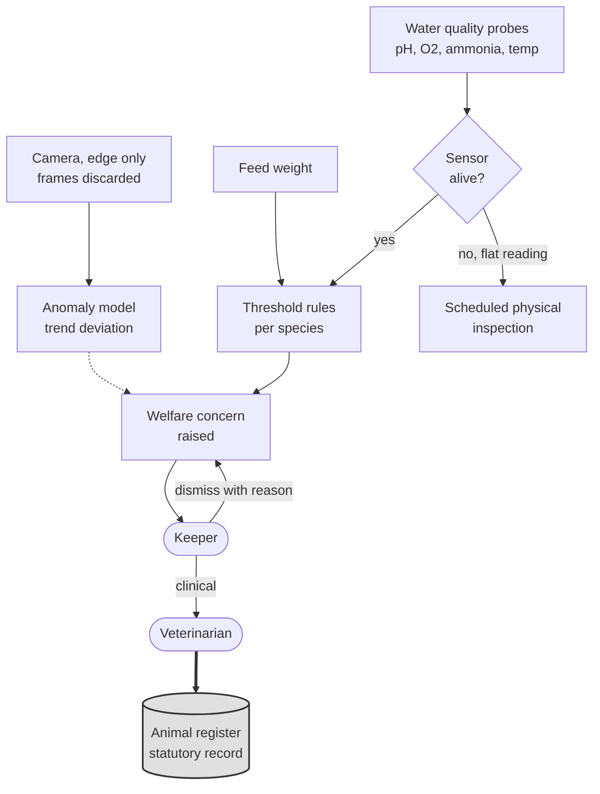

# Animal welfare: aquatic

**Tier 1. Advisory.**

## Purpose

The Countess wants healthy and happy animals, and says illness is what makes the
collection expensive. Aquatic enclosures are separated from terrestrial ones
because the sensing, the failure modes and the physics are genuinely different.

Water is a shared medium. One parameter drifting affects every animal in the
enclosure at once, and it does so before any animal looks unwell. That makes
aquatic welfare the most tractable monitoring problem on the estate, and the one
where early detection saves the most.

## Tier and why

Tier 1. Output is a recommendation to a keeper or veterinarian who decides.
Nothing reaches the statutory animal register except through a human.

## Inputs

| Source | Signal | Rate |
|---|---|---|
| Water quality probes | Temperature, pH, dissolved oxygen, ammonia, nitrite, salinity where relevant | 1 per minute per enclosure |
| Turbidity sensor | Clarity, which also gates the piranha estimate | 1 per minute |
| Feed weight sensor | Quantity delivered and quantity remaining | Per feeding |
| Camera, edge only | Activity level, surface behavior, feeding response | Frames processed locally, never stored |
| Keeper observation | Structured note on the zone ops view | Ad hoc, and authoritative |

Cameras are edge only and retain no frames. Activity classification produces a
number; the image is discarded in the same cycle.

## Approach

Two layers, and the first is not AI.

**Threshold rules, per species.** Keepers and a veterinarian define the safe
band for each parameter for each enclosure's occupants. A breach is an alert.
This ships in phase 1, needs no data, and catches the majority of real incidents.

**Anomaly detection on trend.** The interesting failures are inside the bands.
Dissolved oxygen drifting down over four days while staying above the floor.
Feeding response weakening slightly each day. A model trained on that enclosure's
own history flags deviation from its normal, rather than from a universal normal.

The second layer only takes over when it beats the first on false negative rate
over twelve weeks.

## The path from a reading to a record

**Key.** `([rounded])` person or external body · `[box]` component we build ·
`[(cylinder)]` data store · `{diamond}` decision · enclosing box a boundary ·
**gray fill** deterministic floor, no model output permitted ·
**solid** synchronous or direct · **dotted** advisory or best effort.
Full notation: [../../03-architecture/3_10-diagram-legend.md](../../03-architecture/3_10-diagram-legend.md).

Three things this makes visible. The sensor liveness check sits **before** the
model, because a failed probe reporting a constant perfect value looks exactly
like a healthy enclosure and a model trained on real data will agree with it.
The threshold rules and the anomaly model both feed the same concern, with the
model dotted because it is advisory over a baseline that never goes away. And
only the veterinarian's arrow reaches the register.

## Why false negatives dominate the design

A false negative means a sick animal is missed. Cost: veterinary treatment, a
possible death, welfare failure, and a licensing exposure.

A false positive means a keeper checks an animal that is fine. Cost: twenty
minutes.

These are not symmetric and we refuse to optimize a symmetric accuracy metric
that hides it. Thresholds are tuned toward over-alerting, FF-24 sets false
negative rate under 2 percent, and when it is breached the automatic response is
to lower the threshold and accept more false positives.

The constraint on over-alerting is not precision, it is the alert budget in
FF-08. We would rather a keeper checks a healthy fish than misses a sick one, but
not so often that they stop reading alerts. That tension is the real design
problem here, and override rate is how we watch it.

## Fallback

| Condition | Behavior |
|---|---|
| Cloud link down | Continues at edge, alerts to the zone ops view on the keeper's tablet |
| Model provider down | Threshold rules only. This is the baseline, it never went away |
| Zone Node down | **Enclosure reverts to scheduled physical inspection.** The keeper is told which enclosures are unmonitored |
| Sensor failure | Liveness check independent of the model. A flat reading is treated as a fault, not as good news |
| Evaluation breach | Threshold rules only |

The sensor liveness check deserves emphasis. A failed probe reporting a constant
perfect value looks exactly like a healthy enclosure, and a model trained on
real data will happily agree with it. Detecting that requires a check that does
not consult the model at all.

## Verification

| What | How | Threshold |
|---|---|---|
| False negative rate | Withheld historical incidents, per enclosure | Under 2 percent (FF-24) |
| Alert volume | Alert budget | Within FF-08 ceiling |
| Override rate | Keeper decisions logged | Under 20 percent, above triggers model review (FF-30) |
| Sensor liveness | Independent check | Fault detected within 15 minutes |
| Drift | Input distribution against training window | PSI under 0.2 (FF-31) |
| Register integrity | Reconstruction sample | 100 percent, and no model-authored entries (FF-09) |

## What the keeper sees

An alert carries the recommendation, the readings behind it, the trend over the
relevant window, what normal looks like for that enclosure, **what the threshold
rules say** when they disagree with the model, and what was decided in similar
recent cases.

Dismissing it takes one action and an optional reason. See
[5_4](../../05-ai-assurance/5_4-human-in-the-loop.md) for why we made
disagreement deliberately easy.

## Cold start

Phase 1 launches on threshold rules written by keepers, which requires no data
and no model. Twelve weeks of operation produces enough incident history to
evaluate a candidate anomaly model. Switchover only on beating the baseline.

Full detail in
[5_6](../../05-ai-assurance/5_6-cold-start-strategy.md).
