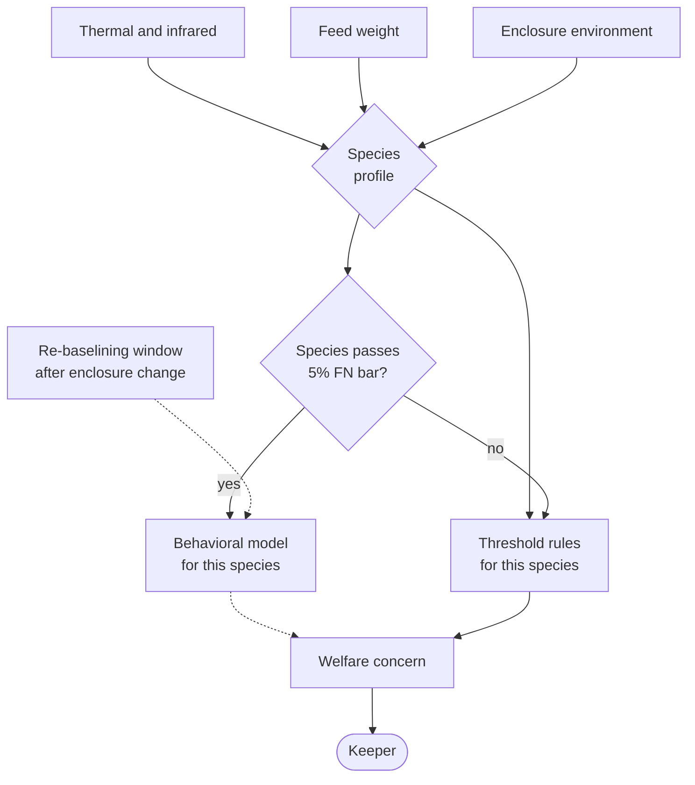

# Animal welfare: terrestrial

**Tier 1. Advisory.**

## Purpose

The same goal as [aquatic](../animal-welfare-aquatic/), a different physics
problem. Land animals do not share a medium, so there is no early warning
equivalent to water chemistry. Illness shows in behavior, and behavior varies
enormously between species.

## Tier and why

Tier 1. Advisory to a keeper or veterinarian. Nothing reaches the statutory
register except through a human.

## Inputs

| Source | Signal | Notes |
|---|---|---|
| Thermal and infrared | Activity, resting position, presence | Works for nocturnal species where visible light does not |
| Feed weight sensor | Delivered and remaining | The single most reliable welfare signal available |
| Environmental sensors | Enclosure temperature, humidity | Per species safe bands |
| Camera, edge only | Gait, posture, activity band | Frames processed locally, never stored |
| Keeper observation | Structured note | Authoritative |

## Approach and baseline

**Baseline:** feeding quantity deviation and activity band thresholds, written
per species by keepers. No model, phase 1.

**Model:** per species anomaly detection on behavioral trend. Switchover
requires beating the baseline on false negative rate over twelve weeks, per
species.

## Per species routing

**Key.** `([rounded])` person or external body · `[box]` component we build ·
`[(cylinder)]` data store · `{diamond}` decision · enclosing box a boundary ·
**gray fill** deterministic floor, no model output permitted ·
**solid** synchronous or direct · **dotted** advisory or best effort.
Full notation: [../../03-architecture/3_10-diagram-legend.md](../../03-architecture/3_10-diagram-legend.md).

The gate is the point. A species whose model fails the 5 percent false negative
bar falls back to threshold rules rather than dragging down an aggregate that
looks acceptable. With 200 animals across 55 enclosures, one model for all of
them would report that a healthy nocturnal reptile had stopped moving.

## Why per species matters here more than anywhere else

A model tuned on a diurnal mammal applied to a nocturnal reptile will report
that a perfectly healthy animal has stopped moving. With 200 animals across 55
enclosures the temptation to build one model is strong and wrong.

FF-25 requires a per species accuracy breakdown, with no species above 5 percent
false negative rate even when the overall figure looks fine. A species failing
that bar reverts to threshold rules rather than dragging down an average.

## Asymmetric errors

Identical reasoning to the aquatic case. A missed illness costs an animal, a
false alarm costs twenty minutes. We tune toward over-alerting, bounded by the
alert budget in FF-08 rather than by precision.

## Fallback

| Condition | Behavior |
|---|---|
| Cloud link down | Continues at edge, alerts locally |
| Model provider down | Threshold rules |
| Zone Node down | Scheduled physical inspection, keeper told which enclosures are unmonitored |
| Sensor failure | Liveness check independent of the model |
| Evaluation breach | Threshold rules, per species |

## Verification

| What | How | Threshold |
|---|---|---|
| False negative rate | Withheld incidents | Under 2 percent overall, **no species above 5 percent** (FF-25) |
| Override rate | Keeper decisions | Under 20 percent (FF-30) |
| Drift after enclosure change | Input distribution | PSI under 0.2 (FF-31) |
| Sensor liveness | Independent check | Fault within 15 minutes |

## The enclosure change problem

Terrestrial enclosures get rearranged. New furniture, new planting, a changed
heat lamp. To a behavioral model this looks like the animal changed, and the
alerts that follow are all false.

Any enclosure modification is recorded as an event, and the affected model
enters a supervised re-baselining window rather than continuing to alert against
a world that no longer exists. This is a small piece of process that prevents a
large class of nuisance alerts, and nuisance alerts are how welfare monitoring
loses the keepers' trust.
