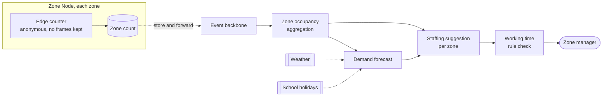

# Footfall and staffing

**Tier 1. Advisory. The capability most constrained by law.**

## Purpose

Two of the Countess's stated problems in one place: knowing which parts of the
estate are popular, and knowing where to put staff.

## Tier and why

Tier 1, and it sits closer to a regulatory boundary than anything else we build.
Both EU AI Act Annex III and BetrVG section 87(1)(6) are in play, from different
directions, and they agree on where the line is.

## The constraint that shaped everything

Under BetrVG section 87(1)(6), a works council has co-determination over any
technical system **capable** of monitoring employee performance. Capability is
the trigger, not intent. A system that could produce per-staff productivity
figures requires their agreement whether or not anyone intends to look.

Separately, EU AI Act Annex III classifies AI used for task allocation based on
individual behaviour or traits in employment as high risk, which would bring
conformity assessment and a quality management system.

We designed to stay clear of both:

| Design choice | Consequence |
|---|---|
| Inputs are zone occupancy counts only | No individual behaviour or traits processed |
| Output is a zone level staffing suggestion | Allocates effort to places, not tasks to people |
| A human assigns individuals | The system never allocates a task to a named person |
| No staff identifier exists in any analytics schema | FF-29 asserts this on every commit and every run. **Build fails otherwise** |

The last row is what makes this an architecture rather than a policy. A works
council asking whether the system can monitor individuals gets an answer from
build history rather than from a design document. See QS-10 in
[2_5](../../02-requirements/2_5-quality-scenarios.md).

## How it works

**Key.** `([rounded])` person · `[box]` component we build · `[(cylinder)]` data store ·
`[[double bar]]` third party · enclosing box a boundary ·
**solid** synchronous · **dotted** best effort or store and forward.
Full notation: [../../03-architecture/3_10-diagram-legend.md](../../03-architecture/3_10-diagram-legend.md).

Note what is absent. There is no staff roster feeding in, no individual
location, no per-person output. The manager is the only place a person is named.

## Counting without identifying

Cameras at zone boundaries count people crossing. Processing is on the Zone
Node, frames are discarded in the same cycle, and nothing leaves except a
number. No faces, no biometrics, no re-identification across zones.

This is a DPIA requirement (children are present), an AI Act constraint, and it
also happens to be the cheapest option, since shipping video would dominate the
bandwidth budget.

It costs us something real. Without re-identification we cannot follow a visitor
journey through the estate, so we know a zone is busy but not what people did
before arriving. We accepted that, and it is why the separated child feature is
not in this architecture. That is the decision we are least sure of, and it is
recorded as open in [OPEN-QUESTIONS.md](../../OPEN-QUESTIONS.md).

## Approach and baseline

**Baseline:** forecast occupancy divided by a staffing ratio per zone, written
by estate management. No model, ships in phase 1.

**Model:** demand forecast per zone from history, weather band, day of week,
season and school holiday calendar, feeding a staffing suggestion.

Switchover requires beating the ratio rule on manager acceptance over eight
weeks. Note the metric: not forecast accuracy, but whether managers actually
act on it. A more accurate forecast that managers ignore has not improved
anything.

## Fallback

| Condition | Behavior |
|---|---|
| Cloud link down | Last advice remains on the ops console, marked stale |
| Model provider down | Occupancy divided by staffing ratio |
| Zone Node down | Zone excluded from advice, shown as unknown |
| Cost ceiling | Suspended. It is advisory and weekly |
| Evaluation breach | Ratio rule |

## Verification

| What | How | Threshold |
|---|---|---|
| **No individual staff data** | Schema assertion | Zero identifying fields, build fails otherwise (FF-29) |
| Working time compliance | Rule check outside the model | No suggestion breaching rest periods (ArbZG) |
| Counting bias | Per zone calibration against manual counts | Monthly, correction applied per zone |
| Forecast quality | Comparison against baseline | Beat by 10 percent MAPE over 8 weeks (FF-28) |
| **Override rate** | Manager decisions | **Near zero is investigated**, not celebrated (FF-30) |

The last row is deliberately inverted. If managers accept every suggestion, the
human is rubber-stamping, and human judgment is the entire legal basis for
keeping this capability out of the high risk category. Total compliance would be
a finding, not a success.

## Counting bias is the quiet failure

Edge counting is not uniformly accurate. A zone with backlit entrances in
afternoon sun undercounts. A narrow gate double-counts people who step back.
These biases are systematic and stable, which means they look like real
differences in popularity.

If the estate invests in the wrong zone because the camera there undercounts, we
have caused the exact mistake the Countess hired us to prevent. Monthly manual
calibration per zone is cheap and is the only way to catch it.
