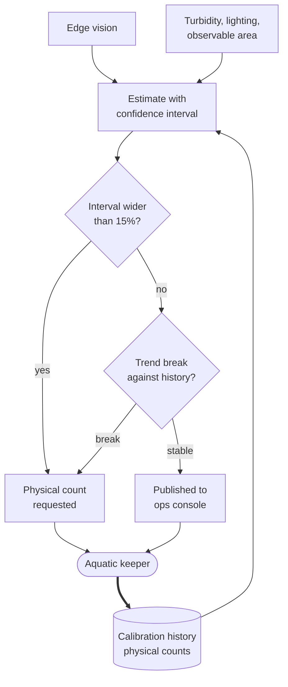

# Piranha population

**Tier 1. Advisory. The one where honesty about uncertainty is the design.**

## Purpose

The brief asks explicitly: for the jumping piranha collection, check population
levels.

## Why this is hard

Counting fish in an enclosure is not a solved computer vision problem. They
move, they occlude each other, they are numerous, and the water is not always
clear. Turbidity varies seasonally and after feeding.

A system that answers "247" is claiming precision the evidence does not support.
The failure is not that the number is wrong, it is that nobody can tell it is
wrong, so it gets used.

## Tier and why

Tier 1. Advisory to an aquatic keeper, who decides whether to physically verify.

## Approach

**A 95 percent prediction interval, never a count.** Edge vision produces a
population estimate with a calibrated interval conditioned on turbidity,
lighting, and how much of the enclosure was observable. Width is `high` minus
`low` as a proportion of the estimate.

**Refuse to estimate outside calibration.** The output is a tagged type,
`Estimate` or `MeasurementUnavailable`, not a number that may be missing. When
conditions fall outside the range the calibration covers, the result is an
explicit refusal carrying its reason. A very wide interval implies the number
inside it still means something, and outside calibration it does not.

**Alert on absolute bounds and on trend.** Keepers and a veterinarian set
absolute bounds per enclosure for capacity, welfare and mortality. Trend break
catches gradual change. An earlier design alerted on trend alone, which would
have missed a population sitting outside a safe absolute range but holding
steady.

**Calibrate against physical counts.** Periodic physical counts are the ground
truth. They are expensive, so they are used to calibrate the model rather than
to operate the exhibit.

**Trigger verification when precision degrades.** When the interval exceeds 15
percent of the estimate, the system asks for a physical count rather than
continuing to publish a number it does not trust.

## The estimate loop

**Key.** `([rounded])` person or external body · `[box]` component we build ·
`[(cylinder)]` data store · `{diamond}` decision · enclosing box a boundary ·
**gray fill** deterministic floor, no model output permitted ·
**solid** synchronous or direct · **dotted** advisory or best effort.
Full notation: [../../03-architecture/3_10-diagram-legend.md](../../03-architecture/3_10-diagram-legend.md).

There is no path from the model to a published number that skips the interval.
Degrading conditions widen the interval, a wide interval asks a human to go and
look, and the physical count feeds back as calibration. The system is designed
to notice when it has stopped being able to see.

## Baseline

Monthly physical count. This is the phase 1 behavior and it never goes away. The
model provides interim estimates between counts; it does not replace them.

## Fallback

| Condition | Behavior |
|---|---|
| Cloud link down | Estimate produced locally, published on reconnect |
| Model provider down | Last calibration holds, estimate continues at edge |
| Zone Node down | Physical count schedule unchanged |
| High turbidity | Interval widens, verification triggered at 15 percent |
| Evaluation breach | Physical counts only |

## Verification

| What | How | Threshold |
|---|---|---|
| **Tagged output** | Structural check. Every `Estimate` carries an interval, every refusal is explicit | **A bare number fails the build** (FF-26) |
| **Interval honesty** | Prediction interval coverage against independent physical counts. One sided lower Wilson bound, strata across every conditioning dimension | Minimum 120 paired observations, 30 per stratum, lower bound above 0.90 against nominal 0.95 (FF-33) |
| Provisional labelling | Below the sample minimum | Estimates published as provisional, keeper told calibration is unproven |
| Refusal outside calibration | Structural | 100 percent of out of distribution observations return "measurement unavailable" (FF-34) |
| Interval width | Monitored daily | Above 0.15 triggers physical verification, never suppression (FF-27) |
| Systematic bias | Comparison against physical counts | Bias correction, or the capability is withdrawn |
| Trend break detection | Against physical count history | Alert on break regardless of interval width |

FF-26 is the only fitness function in this repository that makes a build fail
over an output format. It is worth it. The entire value of this capability is
that it communicates its own uncertainty, and a single code path that returns a
bare integer destroys that.

## What this scenario is really demonstrating

Every team in this kata will be asked to count the piranhas. The tempting answer
is a camera and a detection model, reported as a number, and it will demo well.

Our answer is that the honest output of an unreliable measurement is a
distribution, that the useful signal is the trend rather than the value, and
that the system should ask a human to go and look when it stops being able to
see properly.

That is a smaller claim than a headcount, and it is the one that survives
contact with murky water.
