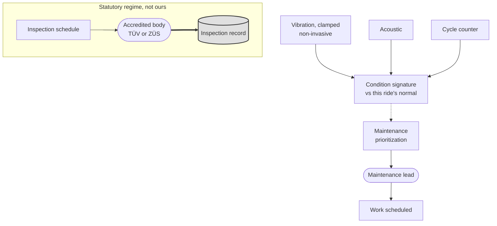

# Predictive maintenance

**Tier 1. Advisory. It never replaces a statutory inspection.**

## Purpose

Forty 18th century rides, recently through safety inspection. Unplanned
downtime on a busy Saturday costs revenue and visitor goodwill, and condition
data can bring maintenance forward before a failure rather than after.

## The constraint that bounds this entirely

Rides are inspected by ZÜS or TÜV under BetrSichV and DIN EN 13814. That
inspection is a legal process performed by an accredited body. Nothing we build
substitutes for it, shortens it, or provides evidence that would let it be
skipped.

Our output is maintenance prioritization between inspections. FR-503 states it,
and it is the boundary that keeps this capability sane.

## The second constraint: heritage

The rides are protected structures under BayDSchG. Sensors cannot be drilled,
bolted or permanently fixed. Everything is non-invasive, battery powered, and
removable, which limits placement and therefore signal quality.

This is a real limitation and it shapes expectations. We are inferring condition
from vibration and acoustic signature at sub-optimal sensor positions, not from
a properly instrumented machine.

## Where our output stops

**Key.** `([rounded])` person or external body · `[box]` component we build ·
`[(cylinder)]` data store · `{diamond}` decision · enclosing box a boundary ·
**gray fill** deterministic floor, no model output permitted ·
**solid** synchronous or direct · **dotted** advisory or best effort.
Full notation: [../../03-architecture/3_10-diagram-legend.md](../../03-architecture/3_10-diagram-legend.md).

The two halves of this diagram do not touch, and that is the design. Our
condition signal prioritizes maintenance work between inspections. The statutory
inspection regime runs on its own schedule, performed by an accredited body,
and nothing we produce is evidence within it.

## Inputs

| Source | Signal |
|---|---|
| Vibration sensor, clamped | Frequency signature per ride cycle |
| Acoustic sensor | Bearing and drive noise |
| Cycle counter | Utilization, which drives wear |
| Environmental | Temperature, humidity, which affect 18th century materials more than modern ones |
| Maintenance log | What was done, when, and what was found |

## Approach and baseline

**Baseline:** manufacturer intervals plus the statutory inspection schedule.
This is what the estate does today and it is not inadequate, merely uninformed.

**Model:** deviation in vibration or acoustic signature against that ride's own
established normal, producing a prioritization signal.

Switchover requires demonstrating useful lead time on three real events. That is
a slow bar, deliberately. Predictive maintenance claims are easy to make and
hard to substantiate, and a model that has never predicted anything real has not
earned a place in a maintenance decision.

## Fallback

| Condition | Behavior |
|---|---|
| Cloud link down | Telemetry buffers. No live advice is needed for a weekly decision |
| Model provider down | Manufacturer intervals |
| Zone Node down | Telemetry gap logged against the ride |
| Cost ceiling | Suspended |
| Evaluation breach | Manufacturer intervals |

## Verification

| What | How | Threshold |
|---|---|---|
| Lead time | Against real maintenance events | Demonstrated on 3 events before switchover |
| Auditability | Advice recorded with the evidence behind it | 100 percent reconstructable (FF-09) |
| **Inspection boundary** | Design review | No model output appears in any statutory inspection record (FR-503) |
| Override rate | Maintenance lead decisions | Under 20 percent (FF-30) |

## What we will not claim

We will not claim this predicts failures. With non-invasive sensors on
18th century machinery and no failure history to train on, the honest
description is that it ranks rides by how much their signature has changed, and
a maintenance lead decides what that is worth.

Calling that prediction would be the kind of overreach that makes an
architecture document untrustworthy everywhere else.
