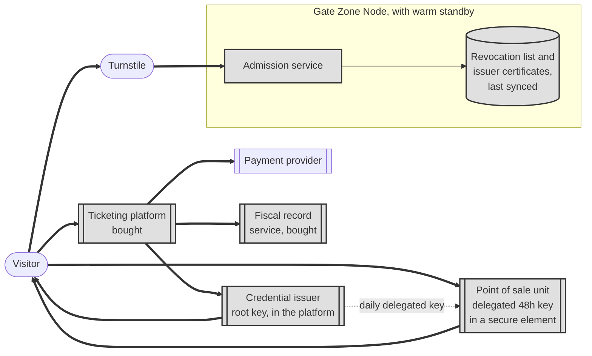

# Ticketing and passes

**Tier 0. No AI. This is the deliberate one.**

## Purpose

Visitors buy tickets, including family passes, and get into the estate. It is the
revenue path, and it is the capability the estate cannot trade one hour of
downtime for.

## Tier and why

Tier 0, the deterministic floor. No model output may appear anywhere in this
path.

We considered three places AI could plausibly go and declined all three.

| Tempting use | Why we said no |
|---|---|
| Dynamic pricing driven by a demand model | Price is a contractual term. PAngV requires total price transparency, AGG constrains segmentation, and a pricing error is a legal and reputational event, not a degraded feature. A rules-based seasonal pricing table achieves most of the benefit with none of the exposure |
| Fraud detection on ticket purchase | Card fraud is the payment provider's problem and they are better at it. Adding a model here would create a false positive path that refuses real families at a gate |
| Conversational ticket purchase | A checkout that sometimes misunderstands is a checkout that sometimes sells the wrong thing. The form works |

The full reasoning is in
[ADR-0003](../../07-decisions/ADR-0003-no-ai-in-the-revenue-path.md).

## How it works

**Key.** `([rounded])` person or device · `[box]` component we build ·
`[(cylinder)]` data store · `[[double bar]]` third party or bought product ·
**gray fill** deterministic floor, no model output permitted ·
**solid** synchronous · **dotted** provisioned opportunistically ·
**thick** the revenue path.
Full notation: [../../03-architecture/3_10-diagram-legend.md](../../03-architecture/3_10-diagram-legend.md).

The mechanism that makes this work on a patchy network is the **signed
credential**. At purchase, the estate issues a cryptographically signed token
carrying the product, validity window and group size. A turnstile verifies the
signature locally, with no network round trip, and checks it against the last
revocation list it received.

Transit systems have done this for two decades. It is not novel, and novelty
would be a defect here.

On-site sales work the same way through a cloud outage because the point of
sale unit signs with a delegated key, valid 48 hours, that the platform's root
key certified. The gate holds the issuer certificates alongside the revocation
list, so a ticket sold at the kiosk during the outage is verified at the
turnstile a minute later. Only the gate zone runs the admission service, since
admission is a perimeter concern, and that node is the one with a warm standby
([ADR-0004](../../07-decisions/ADR-0004-offline-verifiable-ticket-credentials.md),
[ADR-0002](../../07-decisions/ADR-0002-zone-based-edge-architecture.md)).

## Family passes are the hard part

Not technically hard, but full of decisions the brief glosses over.

| Question | Our position |
|---|---|
| What is a family? | A defined group size with at least one adult, not a claim about relationships. Verifying relationships would create a data protection obligation for no benefit |
| Transferable? | No. A single-use signed credential per visit, because transferability and offline validation are hard to reconcile without a live revocation check |
| Children's data? | None collected. Group size, not names or ages. Where age determines price, it is checked visually at the gate as it is today |
| Guardian consent | Required only where a child's personal data would be processed, which this design avoids. FR-109 remains for cases where it cannot |
| VAT | Apportioned across zoo admission and ride rates. FR-107 |

The fourth row is a good example of a regulatory constraint improving a design.
Avoiding children's data was initially a compliance move. It also produced a
simpler product with less to get wrong.

## Fallback

There is no fallback, because this is what everything else falls back to. See
the Tier 0 rows of the
[degraded mode matrix](../../03-architecture/3_8-degraded-mode-matrix.md): cloud
link down, model provider down, and cost ceiling reached all leave this path
unaffected.

Gate Zone Node failure is the only real exposure, covered by the warm standby.
If both gate nodes fail, lanes verify signatures alone and single use is
reconciled afterward, with the duplicate window measured.

## Verification

| What | How | Threshold |
|---|---|---|
| Availability | Synthetic admission per zone every 60s | 99.95 percent (FF-01) |
| Cloud independence | Revenue path smoke test with all cloud dependencies stubbed, including an on-site sale followed by admission of the credential it produced | 100 percent pass, every deploy (FF-02) |
| Reconciliation | Simulated four hour outage | Zero lost admissions, zero duplicate charges (FF-05) |
| Credential integrity | Penetration test on forgery and replay | No successful forgery (NFR-20) |
| Fiscal compliance | Record reconstruction sample | 100 percent (FF-09) |
| Accessibility | Audit against EN 301 549 and WCAG 2.2 AA | Conformance (NFR-24) |

Conventional testing, conventional thresholds, no evaluation harness. That is
what Tier 0 means, and the contrast with every other folder in this directory is
the point.
