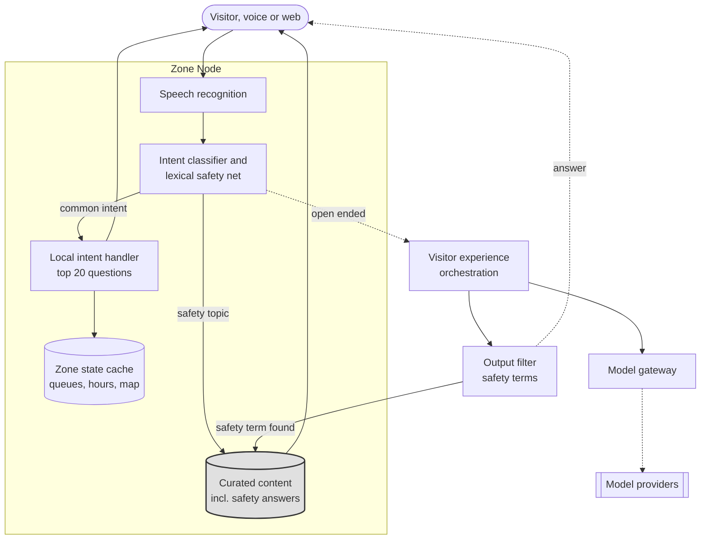

# Visitor experience: the voice concierge

**Tier 2. Visitor facing.**

## Purpose

A visitor in a park has their hands full, often literally with children. They
want to know where the toilets are, how long the queue for the big wheel is,
whether the snakes are out today, and where to get coffee. Voice answers that
without asking them to stop walking and stare at a screen.

It also carries the accessibility case and the multilingual case, which for a
Bavarian estate with international visitors is not a nice extra. See
[accessibility and translation](../accessibility-and-translation/).

## Tier and why

Tier 2. Model output reaches a visitor directly, which means adversarial
exposure and a reputational failure mode, but no legal record and no safety
consequence provided one class of question is removed from its reach.

## How it works

**Key.** `([rounded])` person · `[box]` component we build · `[(cylinder)]` data store ·
`[[double bar]]` third party · enclosing box a boundary ·
**gray fill** deterministic, no model output permitted ·
**solid** synchronous · **dotted** best effort, source survives target failure.
Full notation: [../../03-architecture/3_10-diagram-legend.md](../../03-architecture/3_10-diagram-legend.md).

Three paths, chosen before any generation happens by an intent classifier
and, independently, by a lexical net over safety terms. Either signal is
enough to route a question to curated content.

**Common intents stay in the zone.** Opening hours, directions, queue length,
facilities. These are most of the traffic, they need current zone state rather
than intelligence, and answering them locally costs nothing, survives a cloud
outage, and responds fast.

**Safety topics never reach open generation.** "Is that snake venomous", "can my
child touch it", "what do I do if I am stung". These are answered from content
written by keepers and reviewed by a veterinarian. The model may read it aloud
and may translate it. It may not compose it.

**Open ended queries escalate.** "What should we do with two hours and a
six-year-old who hates heights." This is where generation earns its place, and
it is the only path that costs money.

## Why the safety router exists

We could not find a way to make a generated answer reliable enough for a
question whose wrong answer puts a child near a venomous animal. Prompting,
retrieval, and guardrails all reduce the rate. None of them make it zero, and
the acceptable rate here is zero.

So the class of question is removed from the model's reach rather than made
safer. This is the single most important design decision in the capability, and
it is an architectural constraint rather than a prompt. See QS-05 in
[2_5](../../02-requirements/2_5-quality-scenarios.md).

## The router is a model, and it is tested

It is tempting to call this prevention architectural. It is not, quite. The
routing decision is made by a classifier, a classifier is a model, and a
paraphrased question it misses goes to generation. Removing a class of question from the model's reach depends on
the router catching the class.

So the router is held to the same standard as everything else here, and it
does not stand alone.

| Layer | What it does | Fails how |
|---|---|---|
| Intent classifier | Learns the shape of a safety question, including ones with no obvious keyword | Misses a paraphrase it has not seen |
| Lexical safety net | A short list of terms, in every supported language, that routes to curated content regardless of what the classifier said: venom, bite, sting, touch, stroke, feed, climb, safe, and their translations | Over-routes ordinary questions about feeding times to curated content, which is the safe direction |
| Output filter | Scans a generated answer for the same terms before speech synthesis and replaces it with curated content if one appears | Catches a miss after generation, before the visitor hears it |

The two routing signals are independent by construction. One is statistical,
one is not, and a question has to slip past both. FF-36 measures the router's
recall on the safety golden set and on paraphrases written to defeat a keyword
list, requires every one to end at curated content, and reports how many the
classifier alone would have missed. That number is the residual the second
signal is covering, and it is the one to watch.

## Heuristic baseline

Curated FAQ plus structured wayfinding, no generation. This ships in phase 1 and
**remains permanently** as the fallback for every failure mode.

Unlike other capabilities, generation is not gated behind beating the baseline,
because a FAQ genuinely cannot answer an open-ended question. The baseline is a
floor, not a predecessor.

## Cost

This is the capability most likely to breach the EUR 0.10 ceiling, and the
design is shaped by that.

| Lever | Effect |
|---|---|
| Local intents handled in zone | Removes most traffic from paid inference entirely |
| Aggressive caching of common open queries | Same question from 200 visitors, one inference |
| Small model first, escalate only on low confidence | Most queries never reach an expensive model |
| Budget guard | Open-ended generation is the **first** capability degraded under cost pressure |

## Fallback

| Condition | Behavior |
|---|---|
| Cloud link down | Local intents continue. Open ended states the limit and offers staff |
| Model provider down | Curated FAQ |
| Zone Node down | Static signage and staff |
| Cost ceiling | Open ended degrades first, local intents unaffected |
| Evaluation breach | Curated FAQ |

## Verification

| What | How | Threshold |
|---|---|---|
| Answer correctness | Golden set of 300 visitor questions | 95 percent correct, **zero confidently wrong on safety** (FF-21) |
| Adversarial resistance | Injection, jailbreak, off-topic coercion suite | Zero policy violations in 200 attempts, per release and weekly in production (FF-22) |
| Speech recognition compounding | Error injection at 10 percent word error rate | Correctness holds above 90 percent (FF-23) |
| Safety routing recall | Safety golden set plus paraphrases, both signals evaluated | 100 percent routed to curated content, classifier-only misses reported (FF-36) |
| AI disclosure | Per session | Present, checked in the golden set (FR-203) |
| Cost | Rolling spend per scanned admission | Under EUR 0.10, guard at 0.08 (FF-11) |
| Production sampling | Human review | 50 per week, **100 percent of safety-classified turns** (FF-32) |

FF-23 is the one most teams will miss. Speech recognition errors compound with
model errors, so evaluating the language model on clean text tells you very
little about what a visitor actually experiences in a noisy park with a Bavarian
accent or a Japanese one. The pipeline is evaluated end to end.

## Failure modes

See [5_5](../../05-ai-assurance/5_5-failure-mode-taxonomy.md) for the full table,
including hallucination on fact, prompt injection, language degradation, and
latency or cost spike.

The notable entry is hallucination on safety. The prevention depends on a
router, and a router is a model, so the row names the two routing signals, the
output filter, and the fitness function that measures the router's recall,
rather than claiming the class is unreachable.
