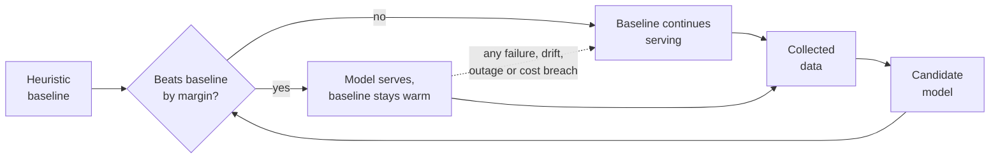

# Cold start strategy

*There is no historical data. Every model in this architecture starts blind.*

## The problem

The organizers confirmed this is greenfield. The estate has never instrumented
anything, so on opening day there is no attendance history, no digital feeding
records, no labeled animal imagery, and no visitor interactions.

Every team in this kata will propose demand forecasting. Almost none will
explain what it forecasts from in month one.

## The answer: heuristics first, permanently

Each capability ships first as an explicit rule set built from domain knowledge
and external signals. The model replaces it only when it beats it. The rule set
is never deleted.

**Key.** `[box]` component or state · `{diamond}` decision ·
**solid** progression · **dotted** fallback on failure.
Full notation: [../03-architecture/3_10-diagram-legend.md](../03-architecture/3_10-diagram-legend.md).

The loop is the point. Data collected while the baseline serves is what trains
the model that eventually replaces it, and the baseline stays warm to catch the
model when it falls over.

## Baseline per capability

| Capability | Heuristic baseline at launch | External signals | Switchover condition |
|---|---|---|---|
| Demand forecasting | Day of week, season, school holiday, weather band, lookup table | Weather service, Bavarian school holiday calendar | Model beats baseline by 10 percent MAPE over 8 weeks (FF-28) |
| Zone occupancy | Direct sensor counts, no inference | none | Never. This is measurement, not prediction |
| Animal welfare, aquatic | Fixed per species thresholds on water quality, written by keepers | none | Anomaly model beats threshold rules on false negative rate over 12 weeks |
| Animal welfare, terrestrial | Feeding quantity deviation and activity band thresholds | none | Same, per species |
| Piranha population | Physical count, monthly | none | Estimation model calibrated against 12 physical counts, and only for interim estimates between counts |
| Predictive maintenance | Manufacturer intervals plus inspection schedule | none | Condition model demonstrates lead time on 3 real events |
| Staff deployment | Forecast occupancy divided by a staffing ratio per zone | Forecast, which has its own baseline | Model beats ratio rule on manager acceptance over 8 weeks |
| Voice concierge | Curated FAQ and structured wayfinding, no generation | none | Immediate for open queries. The FAQ remains the fallback permanently |

Two entries deserve comment.

**Zone occupancy has no switchover.** Counting people who are present is
measurement. Adding a model to a measurement problem is a common and expensive
mistake, and we declined it.

**The concierge inverts the pattern.** Generation ships on day one for
open-ended queries, because a curated FAQ genuinely cannot answer them. But the
FAQ is not a stepping stone, it is the permanent fallback for every failure mode
in [5_5](5_5-failure-mode-taxonomy.md).

## Why the baseline is never deleted

It will be tempting in year two. The model works, the rules look like
legacy, and someone will propose cleaning them up.

The rules are not legacy. They are:

- **The fallback** for provider outage, drift, cost breach and failed evaluation
- **The control** that tells you whether the model is actually earning its cost
- **The floor** that means a bad model release degrades service rather than
  removing it

Deleting them converts every graceful degradation in this architecture into an
outage, simultaneously. That is why it appears in
[2_5](../02-requirements/2_5-quality-scenarios.md) as a sensitivity point rather
than as a note.

## What this costs

Honesty requires naming the price. Maintaining two implementations of every
capability is real work, and for a two to three person operations team that is a
meaningful burden. We accept it because the alternative, for an estate whose
network is unreliable and whose model providers may vanish, is a system that
stops working in ways nobody planned for.

It also slows delivery. Capabilities that could ship as models in phase 1 ship
as rules instead, and the model arrives in phase 2 after the data exists. The
Countess gets a working estate sooner and a clever one later, which is the right
order for a business that needs revenue before it needs sophistication.
