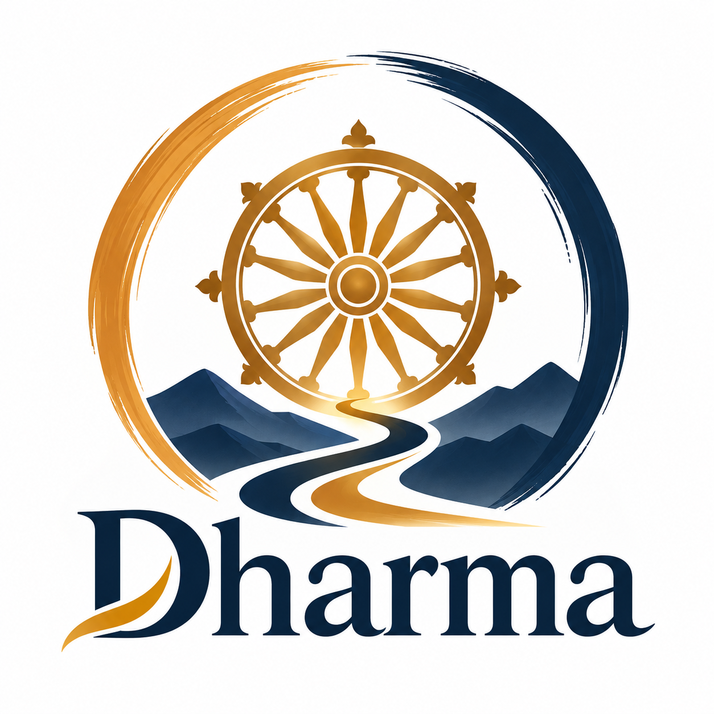

# Team Dharma

Four architects and engineers working across Rajasthan and Uttar Pradesh, India.

| Name | Location | Profile |
|------|----------|---------|
| Vipul Kocher | Uttar Pradesh, India | [LinkedIn](https://www.linkedin.com/in/vipulkocher/) |
| Kirtimaan Lodha | Rajasthan, India | [LinkedIn](https://www.linkedin.com/in/kirtimaan/) |
| Aastha Agarwal | Uttar Pradesh, India | [LinkedIn](https://www.linkedin.com/in/aastha-agarwal-ba402812a/) |
| Chetan Bothra | Rajasthan, India | [LinkedIn](https://www.linkedin.com/in/cbothra/) |

The whole team sits in one timezone (IST, UTC+5:30). Other professional
commitments meant we could not spend much time on this together, and the
README and [09-ai-disclosure/](09-ai-disclosure/) say how the work was
produced.

## How we worked

The kata opened on September 1 and submissions close on September 16. The
team's background is in software testing and AI assurance, which is why
`05-ai-assurance/` is the deepest section. We spent the early days on the
problem and its constraints before drawing anything.
That is why the assumptions register and the regulatory context are numbered
ahead of the first architecture diagram: they are what the diagrams had to
satisfy.

Where a question stayed open, we wrote it down. [OPEN-QUESTIONS.md](OPEN-QUESTIONS.md)
lists what we could not settle in the time available. Any ADR marked
*Superseded* is a decision we reversed, and the replacement says why.

## Who owned what

| Section | Primary owner |
|---|---|
| `01-problem/`, `02-requirements/`, `03-architecture/`, `07-decisions/` | Kirtimaan Lodha |
| `05-ai-assurance/`, fitness functions, `10-security/` | Vipul Kocher |
| `04-ai-scenarios/`, `code/` | Chetan Bothra |
| `05-ai-assurance/` evaluation design and ML validation | Aastha Agarwal |
| `06-economics/`, data architecture and governance (`03-architecture/3_11` to `3_13`) | Kirtimaan Lodha and Chetan Bothra |

## The name and the logo

Dharma is a Sanskrit word from the root *dhṛ*, to hold or to sustain. In
Indian thought it names the order that keeps a person, a community or the
world in working balance. We borrowed it because that is what we think
architecture is for. A system exists to serve a purpose, and the architect's
job is to build the structure that keeps serving it after the launch, the
first outage and the third change of ownership.

Four ideas follow from that, and each of them is acted on somewhere in this
repository.

**Purpose before technology.** Start with the problem the system solves and
who pays for it. The cap of EUR 0.10 of AI spend per scanned admission comes from
this. A feature that costs more than it earns was removed.

**Trade-offs made in the open.** Performance against cost, flexibility
against simplicity, availability against consistency. Trade-offs cannot be
removed, only chosen. We chose ours deliberately and wrote them down, which
is why the decision records are the largest folder here.

**Responsibility for consequences.** A line on a diagram becomes someone's
on-call shift, someone's budget and someone's legal exposure. We designed for
what the system will demand of the people who run it, as much as for what it
can do.

**Room to change.** The business, the regulation, the models and the vendors
will all move. The deterministic floor exists so the estate keeps working
while the AI layer above it is swapped, retrained or switched off.

The logo says the same thing in pictures. The golden wheel at the centre is
the dharmachakra. Its spokes stand for the forces an architect balances, and
the wheel turns because architecture is never finished. The blue mountains
are the complexity of the problem, which no design removes. The path through
them winds on purpose. Architecture goes from understanding through options,
trade-offs, decisions and learning, and rarely in a straight line. The
brushstroke circle around everything is the set of boundaries that give a
system its shape, and it is left open on purpose. A closed boundary becomes a
prison. Gold is purpose and judgement. Blue is the engineering discipline
that turns judgement into something that runs.

The wheel is a familiar image from Indian iconography. It is used here as a
design metaphor, not as a religious statement.

In three words: **build what sustains.**
